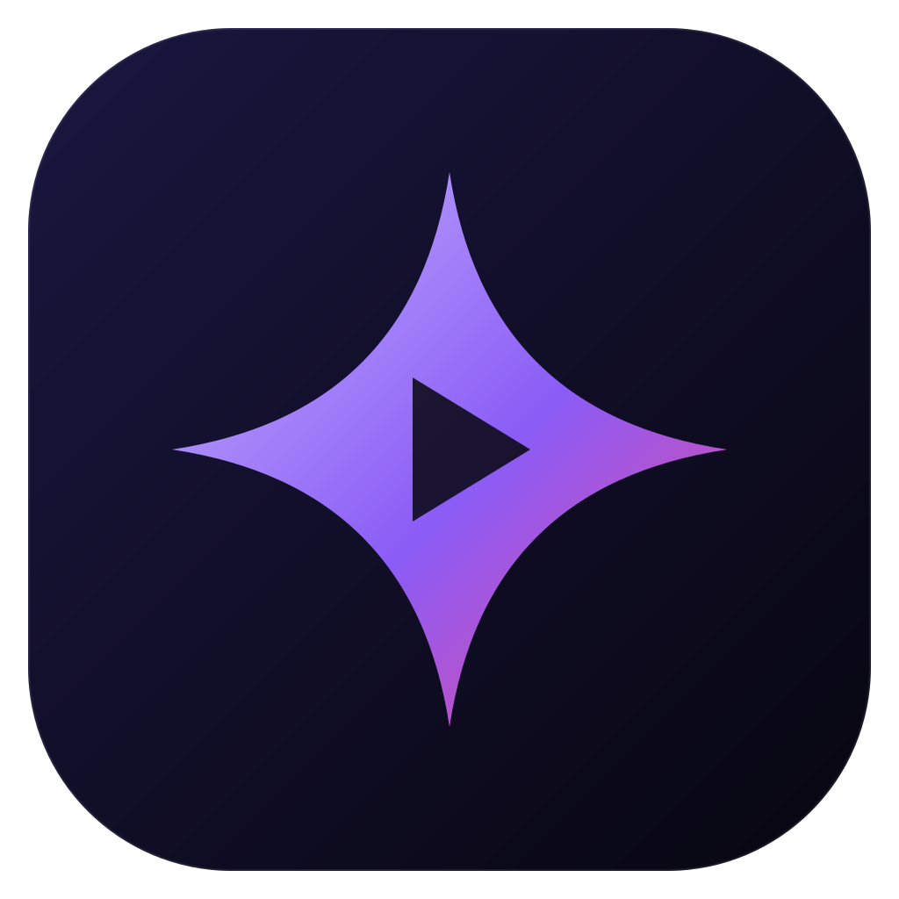
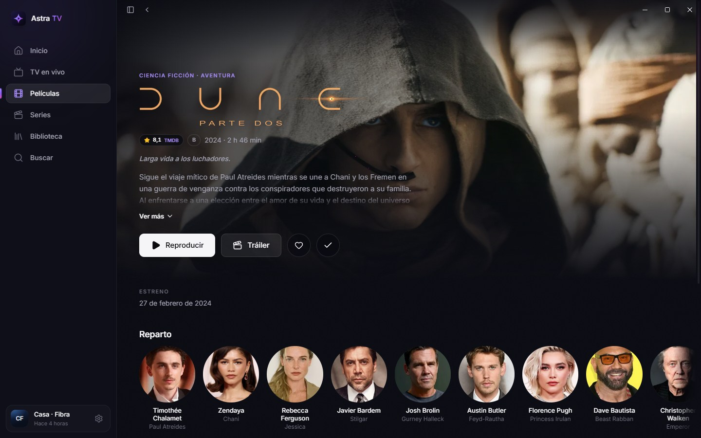
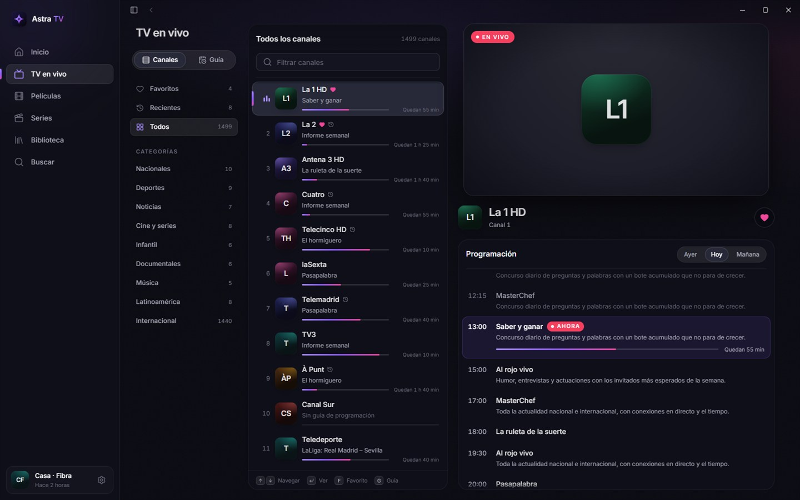
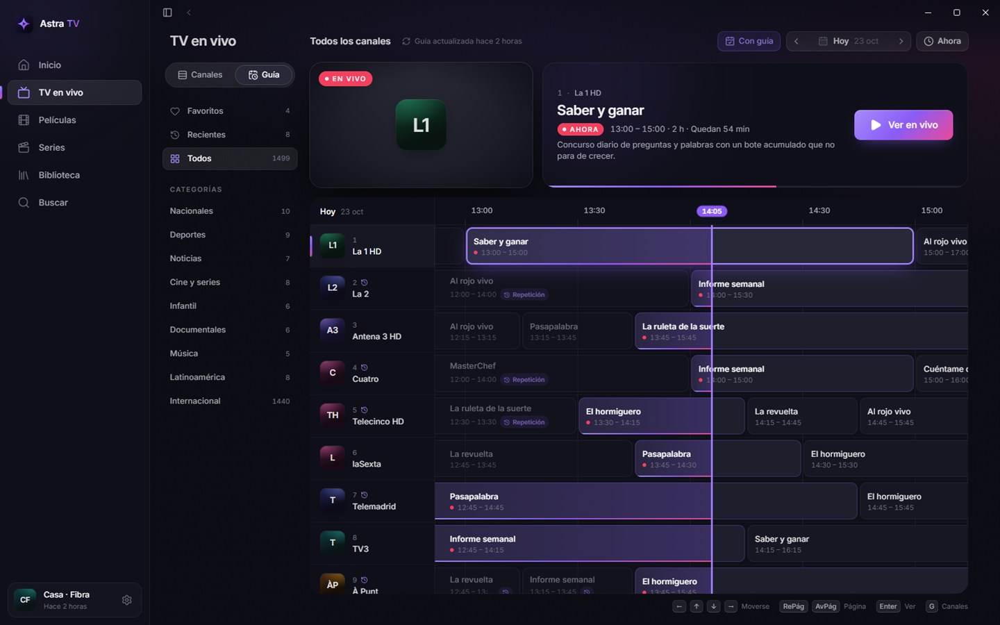
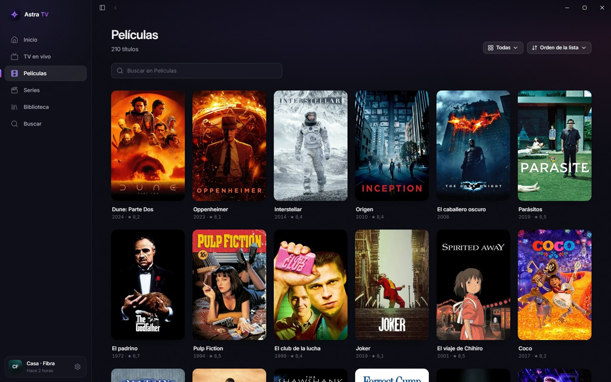
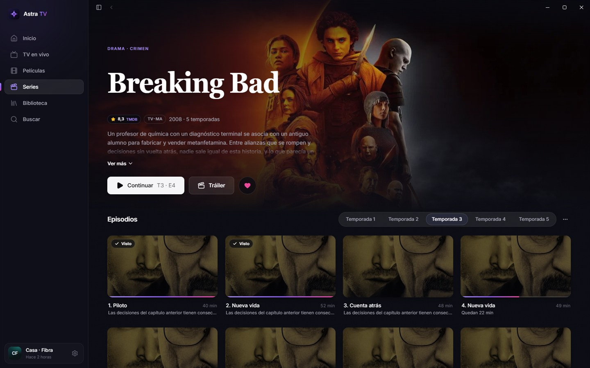
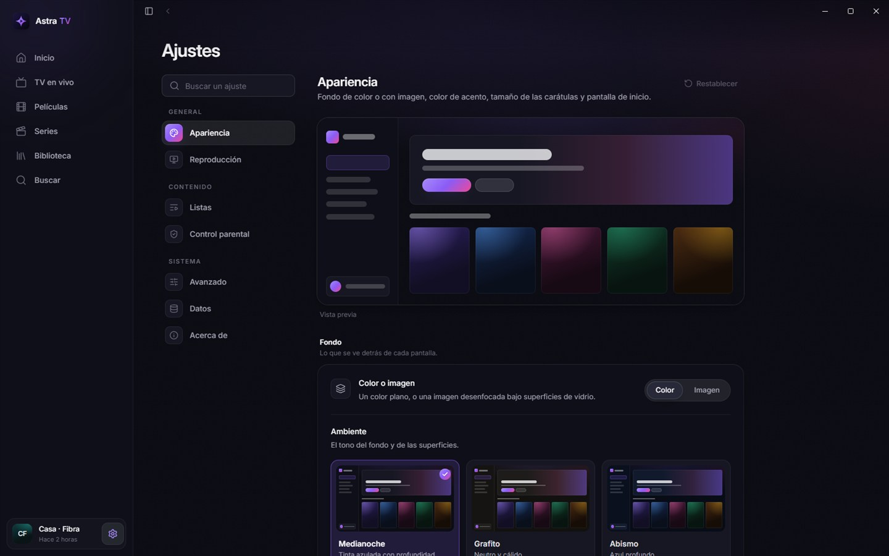

<div align="center">



# Astra TV

### Cine, series y televisión en vivo, con el cuidado que merecen.

Astra TV le da a tu lista Xtream Codes la experiencia de una gran plataforma:<br />
una app para Windows rápida, discreta y pensada hasta el último detalle.

<br />

<a href="https://github.com/sbtcontreras/astra-tv-releases/releases/latest/download/AstraTV.exe"></a>

<br />
<br />

<a href="https://github.com/sbtcontreras/astra-tv-releases/releases/latest"></a>
<a href="https://github.com/sbtcontreras/astra-tv-releases/releases"></a>


<br />
<br />



<sub>Un solo archivo · Sin instalación · Tus datos no salen de tu equipo</sub>

</div>

<br />

<table>
<tr>
<td width="33%" valign="top">

#### Para mirar

Cada título llega con su logo, su mejor imagen, su reparto y su valoración. Tu catálogo deja de ser una lista y se convierte en una cartelera.

</td>
<td width="33%" valign="top">

#### Al instante

El catálogo vive en tu equipo. Abrir una categoría, buscar o cambiar de canal ocurre sin esperas, aunque tu lista tenga miles de títulos.

</td>
<td width="33%" valign="top">

#### Solo tuya

Sin cuentas, sin anuncios, sin rastreo. Tus credenciales viajan únicamente a tu proveedor; todo lo demás se queda contigo.

</td>
</tr>
</table>

<br />

## La señal en vivo, a tu ritmo

Recorre los canales con una vista previa que ya está reproduciendo y consulta la guía de un vistazo. Y si algo te interrumpe, pausa: Astra TV guarda lo último que se emitió para que vuelvas atrás cuando quieras.

<p align="center">
  
  
</p>

- **Guía.** Toda la programación en una grilla, día por día, con lo que se emite ahora siempre a la vista.
- **Repetición.** Los programas que ya pasaron, desde el inicio, cuando tu proveedor los ofrece.
- **Retroceder en vivo.** Pausa, vuelve 10 s o recorre la línea de tiempo, que marca dónde empieza cada programa. **Ir al vivo** te devuelve al presente.
- **Zapping.** Cambia de canal con el teclado, marca su número o vuelve al anterior con Retroceso.
- **Sin cortes.** Si la señal se cae, Astra TV se reconecta sola.

<br />

## Cada título, en su mejor versión

Fichas con logo, sinopsis, reparto, tráiler y valoraciones de TMDB. Astra TV recuerda dónde quedaste, qué idioma prefieres en cada serie y qué episodio viene después.

<p align="center">
  
  
</p>

- **Continuar viendo.** Retoma donde quedaste; al terminar un episodio, el siguiente empieza solo.
- **Idiomas.** El audio y los subtítulos que elegiste se recuerdan por serie, y los subtítulos aparecen cuando el audio está en otro idioma. Si no los trae en español, se buscan en OpenSubtitles; el tamaño, el fondo y la sincronía se ajustan desde el mismo menú.
- **Más como esta.** Sugerencias en cada ficha para descubrir lo próximo.
- **Biblioteca.** Tu historial, día por día, y tus favoritos, siempre a mano.
- **Búsqueda.** Todo el catálogo con Ctrl+K, o solo la categoría abierta con /.

<br />

## El video te acompaña

Sal del reproductor y lo que ves sigue en una esquina mientras exploras; vuelve a expandirlo sin recargar. O déjalo flotando sobre tus otras ventanas con una sola tecla.

- **Imagen.** Ajustar, rellenar, estirar o forzar 16:9, 4:3 y 21:9.
- **Información de la transmisión.** Resolución, video, audio y búfer en tiempo real.
- **Motor mpv.** Arranque rápido y compatibilidad con prácticamente cualquier formato.

<br />

## Hecha a tu medida



Cinco ambientes, de Medianoche a un negro OLED puro, el color de acento que prefieras y una luz ambiental sutil. O un fondo con imagen, tuya o de tu película favorita, desenfocado bajo paneles de vidrio.

- **Varias listas**, cada una con sus datos al día: vencimiento, conexiones y alcance de la guía.
- **Categorías** fijadas, ocultas o protegidas con PIN.
- **Ajustes** con buscador y «Restablecer» por sección.

<br clear="right" />
<br />

## Todo desde el teclado

<table>
<tr>
<td valign="top">

**Reproductor**

| Tecla | Acción |
|---|---|
| <kbd>Espacio</kbd> | Reproducir o pausar |
| <kbd>←</kbd> <kbd>→</kbd> | Retroceder o adelantar 10 s |
| <kbd>↑</kbd> <kbd>↓</kbd> | Volumen |
| <kbd>M</kbd> | Silenciar |
| <kbd>F</kbd> | Pantalla completa |
| <kbd>P</kbd> | Ventana flotante |
| <kbd>C</kbd> | Subtítulos |
| <kbd>Z</kbd> <kbd>X</kbd> | Mostrar los subtítulos antes o después |
| <kbd>A</kbd> | Ajuste de imagen |
| <kbd>I</kbd> | Información de la transmisión |
| <kbd>E</kbd> | Episodios |
| <kbd>Mayús</kbd> <kbd>N</kbd> | Siguiente episodio |

</td>
<td valign="top">

**TV en vivo**

| Tecla | Acción |
|---|---|
| <kbd>RePág</kbd> <kbd>AvPág</kbd> | Canal anterior o siguiente |
| <kbd>0</kbd>–<kbd>9</kbd> | Ir a un canal por su número |
| <kbd>Retroceso</kbd> | Volver al canal anterior |
| <kbd>L</kbd> | Lista de canales |
| <kbd>G</kbd> | Canales o Guía |
| <kbd>Fin</kbd> | Ir al vivo |

**Toda la app**

| Tecla | Acción |
|---|---|
| <kbd>Ctrl</kbd> <kbd>K</kbd> | Buscar |
| <kbd>/</kbd> | Buscar en esta pantalla |

</td>
</tr>
</table>

<br />

## Empieza en un minuto

1. **[Descarga `AstraTV.exe`](https://github.com/sbtcontreras/astra-tv-releases/releases/latest/download/AstraTV.exe)**.
2. Guárdalo donde quieras, incluso en un pendrive, y ábrelo. No hay nada que instalar.
3. Agrega tu lista con el servidor, el usuario y la contraseña de tu proveedor.

Funciona en Windows 10 y 11 de 64 bits.

> [!NOTE]
> Astra TV es un reproductor: no incluye canales, películas ni series. Para usarlo necesitas una lista Xtream Codes de tu proveedor.

### La primera vez

Windows puede mostrar *«Windows protegió tu PC»* al abrir `AstraTV.exe` por primera vez. Haz clic en **Más información** y luego en **Ejecutar de todas formas**. Solo ocurre una vez; si prefieres comprobar el archivo antes, sigue los pasos de [Verificar la descarga](#verificar-la-descarga).

<br />

## Siempre al día

Astra TV busca versiones nuevas al abrirse y cada 6 horas. Antes de instalar una, comprueba su firma digital (ed25519) con la clave incluida en la app; si no coincide, la descarta. Luego solo te pide reiniciar.

Puedes desactivar la búsqueda automática en **Ajustes** y buscar a mano cuando quieras. Lo nuevo de cada versión está en [Versiones](https://github.com/sbtcontreras/astra-tv-releases/releases).

> [!IMPORTANT]
> Si todavía usas la v0.1.0, descarga la última versión desde aquí una sola vez. Desde la v0.2.0, Astra TV se actualiza sola.

<br />

## Tus datos, en tu equipo

Listas, catálogo, favoritos, historial y ajustes se guardan en:

```
%LOCALAPPDATA%\app.astratv.desktop
```

Para empezar de cero, usa **Ajustes › Datos › Borrar todos los datos**.

Para llevar tus listas a otro equipo, expórtalas desde **Ajustes** a un archivo `.astra` e impórtalo allá.

> [!WARNING]
> El archivo `.astra` incluye las contraseñas de tus listas en texto legible. Guárdalo como guardarías una contraseña y compártelo solo por un canal privado.

<br />

## Verificar la descarga

Cada versión publica, junto a `AstraTV.exe`, su huella SHA-256 en `AstraTV.exe.sha256`. Compruébala en PowerShell:

```powershell
(Get-FileHash .\AstraTV.exe -Algorithm SHA256).Hash.ToLower()
Get-Content .\AstraTV.exe.sha256
```

Si el primer valor coincide con el comienzo del segundo, el archivo es exactamente el que se publicó.

<br />

## Preguntas frecuentes

<details>
<summary><b>¿Astra TV incluye canales o contenido?</b></summary>
<br />
No. Astra TV es el reproductor: muestra el catálogo de la lista Xtream Codes que te entrega tu proveedor.
</details>

<details>
<summary><b>¿Funciona con listas M3U?</b></summary>
<br />
Por ahora, solo con listas Xtream Codes (servidor, usuario y contraseña).
</details>

<details>
<summary><b>Un canal se corta a los pocos segundos. ¿Por qué?</b></summary>
<br />
Casi siempre es porque tu cuenta está usando todas sus conexiones, por ejemplo con otro dispositivo viendo la misma lista. Astra TV te avisa cuando llegas al límite, y en <b>Ajustes › Listas</b> puedes ver cuántas conexiones permite tu cuenta.
</details>

<details>
<summary><b>¿Por qué Windows dice que la app no es reconocida?</b></summary>
<br />
SmartScreen avisa de los programas que todavía no descarga mucha gente. Las actualizaciones de Astra TV van firmadas, y puedes comprobar cada descarga con su huella SHA-256 (<a href="#verificar-la-descarga">Verificar la descarga</a>).
</details>

<details>
<summary><b>¿Cómo la desinstalo?</b></summary>
<br />
Borra <code>AstraTV.exe</code>. Si también quieres quitar tus datos, borra la carpeta <code>%LOCALAPPDATA%\app.astratv.desktop</code>.
</details>

<br />
<br />

<div align="center">

<br />
<sub>Astra TV · Para Windows 10 y 11</sub>
</div>
