<div align="center">

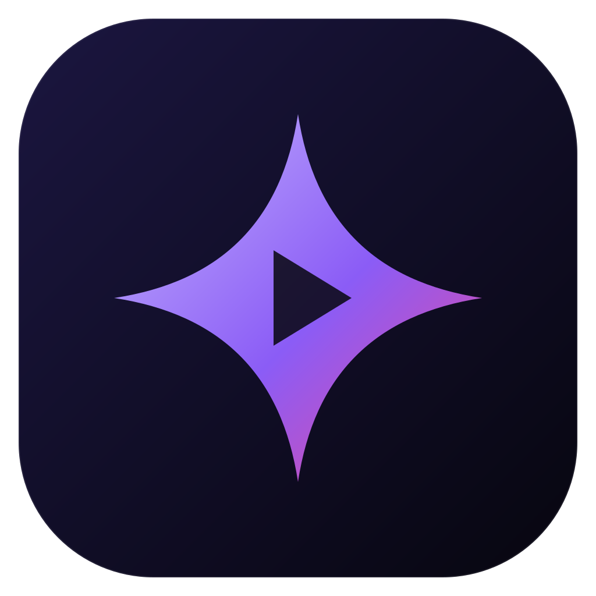

# Astra TV

### Cine, series y televisión en vivo, con el cuidado que merecen.

Astra TV le da a tu lista Xtream Codes la experiencia de una gran plataforma:<br />
TV en vivo con guía y repetición, películas y series con su ficha completa,<br />
en tu PC con Windows, tu TV con Android, tu tablet y tu celular.

<br />

<a href="https://github.com/sbtcontreras/astra-tv-releases/releases/latest/download/AstraTV.exe"></a>
<a href="https://github.com/sbtcontreras/astra-tv-releases/releases/latest/download/AstraTV-arm64-v8a.apk"></a>

<sub>¿Una TV box o un equipo de 32 bits? Descarga <a href="https://github.com/sbtcontreras/astra-tv-releases/releases/latest/download/AstraTV-armeabi-v7a.apk"><code>AstraTV-armeabi-v7a.apk</code></a> · <a href="#64-o-32-bits">¿Cuál es el mío?</a></sub>

<br />
<br />

<a href="https://github.com/sbtcontreras/astra-tv-releases/releases/latest"></a>
<a href="https://github.com/sbtcontreras/astra-tv-releases/releases"></a>
<a href="#en-windows"></a>
<a href="#en-android"></a>

<br />
<br />

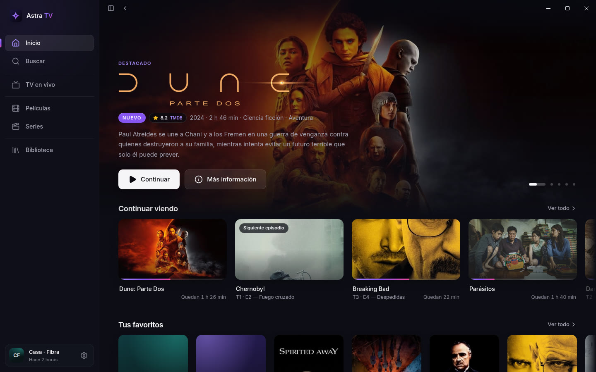

<sub>Windows · Android TV · Tablets · Celulares &nbsp;—&nbsp; Sin cuentas, sin anuncios, sin rastreo</sub>

</div>

<br />

<table>
<tr>
<td width="33%" valign="top">

#### Para mirar

Cada título llega con su nombre en español, su logo, su mejor imagen, su reparto y su valoración. Tu catálogo deja de ser una lista y se convierte en una cartelera.

</td>
<td width="33%" valign="top">

#### Al instante

El catálogo vive en tu equipo. Abrir una categoría, buscar o cambiar de canal ocurre sin esperas, aunque tu lista tenga decenas de miles de títulos.

</td>
<td width="33%" valign="top">

#### Solo tuya

Sin cuentas ni anuncios. Tus credenciales viajan únicamente a tu proveedor; tu historial, tus favoritos y tus ajustes se quedan en tu equipo.

</td>
</tr>
</table>

<br />

## TV en vivo, a tu ritmo

Recorre los canales con una vista previa que ya está reproduciendo y mira qué viene después sin salir de la lista. Si algo te interrumpe, pausa: Astra TV guarda lo último que se emitió para que vuelvas atrás cuando quieras.

<p align="center">
  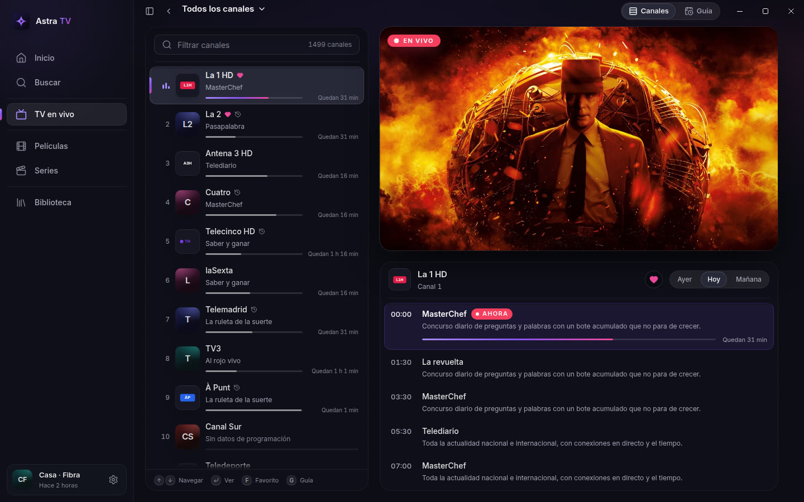
  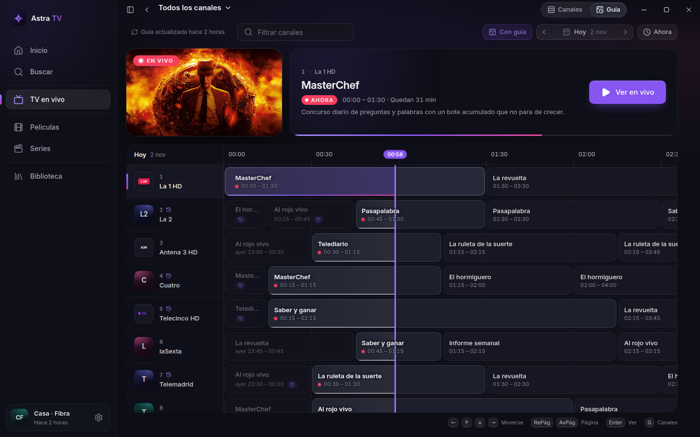
</p>

- **Guía.** Toda la programación en una grilla, día por día, con lo que se emite ahora siempre a la vista.
- **Repetición.** Los programas que ya pasaron, desde su inicio, en los canales donde tu proveedor la ofrece.
- **Retroceder en vivo.** Pausa, vuelve 10 s o recorre la línea de tiempo, que marca dónde empieza cada programa; **Ir al vivo** te devuelve al presente. Cuánto guarda depende de la memoria que le des en *Ajustes › Reproducción*.
- **Zapping.** Cambia de canal con el teclado o con CH+ y CH− del control remoto, marca su número o vuelve al anterior.
- **Sin cortes.** Si la señal se cae, Astra TV se reconecta sola. Si tu cuenta ya usa todas sus conexiones, te lo dice.

<br />

## Películas y series, en su mejor versión

Astra TV reconoce cada título en TMDB, sin que configures nada: su ficha trae logo, sinopsis, reparto, tráiler y valoración, y recuerda dónde quedaste.

<p align="center">
  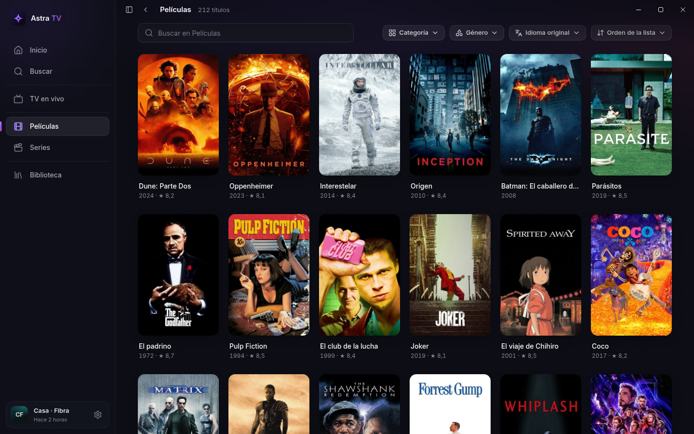
  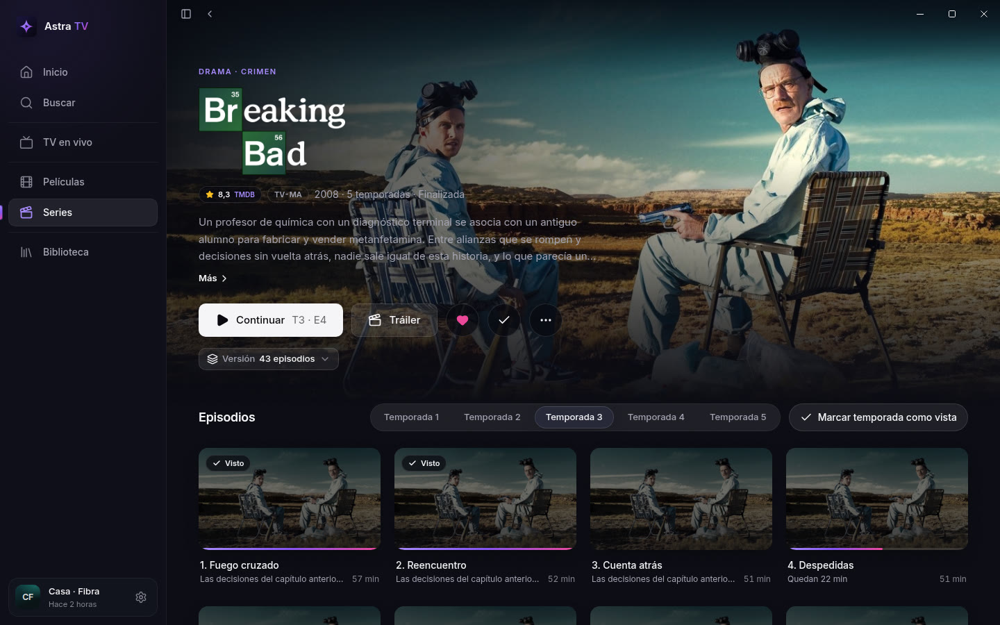
</p>

- **Cada título, una vez.** Si tu lista tiene la misma película en 4K, en FHD y en otra categoría, aparece una sola vez; en su ficha eliges la versión.
- **Filtros que entienden el catálogo.** *Género* e *Idioma original* se combinan con las categorías de tu proveedor: *Animación* + *Japonés* es el anime de tu lista, *Drama* + *Coreano*, sus doramas.
- **Personas.** El reparto y la dirección llevan a la página de cada uno, con lo que tu lista tiene de su trabajo.
- **Continuar viendo.** Retoma donde quedaste; al terminar un episodio, el siguiente empieza solo. *Porque viste…* sugiere lo próximo.
- **Cómo va una serie.** *En emisión*, *Finalizada* o *Cancelada*, y los episodios estrenados que tu lista todavía no tiene.
- **Tráileres** dentro de la aplicación, en español latino cuando existe.
- **Biblioteca.** Tu historial por fecha (hoy, ayer, esta semana y cada mes), tus favoritos y lo que marcaste como visto.
- **Buscar** encuentra títulos, canales, personas, géneros e idiomas, con <kbd>Ctrl</kbd> <kbd>K</kbd> desde cualquier pantalla.

<br />

## Un reproductor que te acompaña

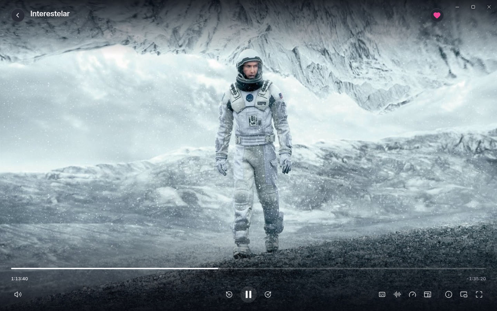

- **Subtítulos que llegan solos.** Aparecen cuando el audio está en otro idioma. Si el título no los trae en español, Astra TV los busca en OpenSubtitles y los agrega; el tamaño, el fondo y la sincronía se ajustan desde el mismo menú.
- **Tus idiomas, por serie.** El audio y los subtítulos que eliges en una serie se recuerdan para sus demás episodios.
- **Miniatura, en Windows.** Sal del reproductor y lo que ves sigue en una esquina mientras exploras; arrástrala a la que prefieras y la próxima vez aparece ahí. O déjalo flotando sobre tus otras ventanas con <kbd>P</kbd>.
- **Imagen.** Ajustar, rellenar, estirar o forzar 16:9, 4:3 y 21:9, e información de la transmisión en tiempo real.
- **Motor mpv.** Arranque rápido, decodificación por hardware y compatibilidad con prácticamente cualquier formato.

<br />

## En la TV, la tablet y el celular

<p align="center">
  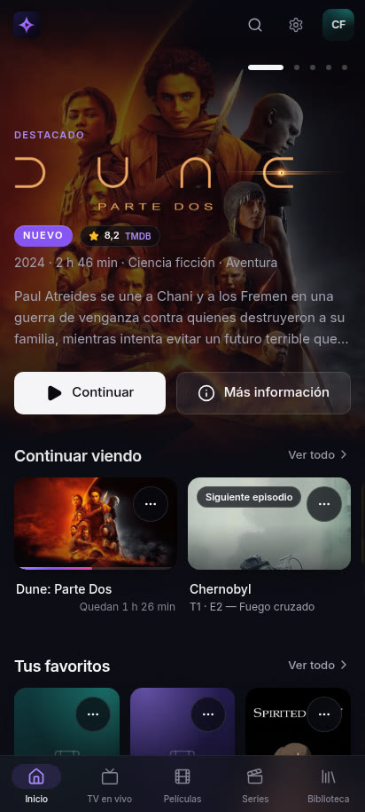
  &nbsp;
  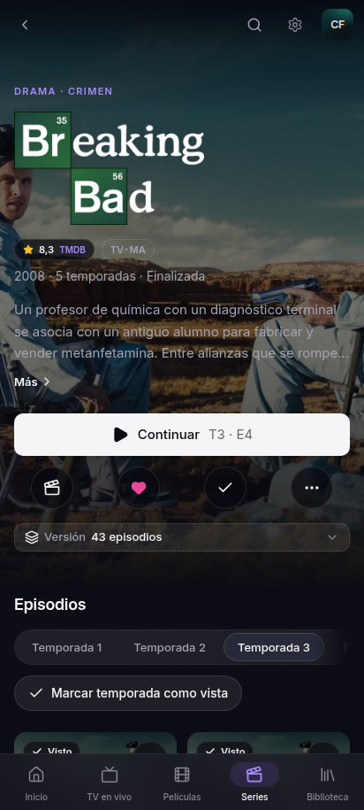
  &nbsp;
  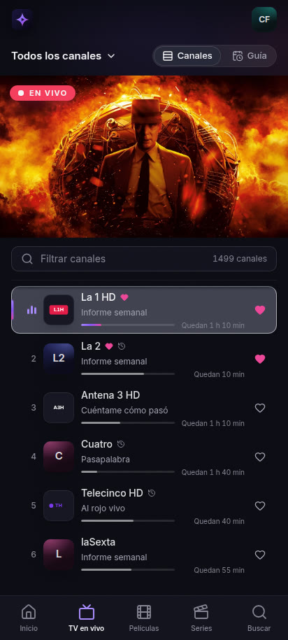
</p>

- **Con el control remoto.** Las flechas llevan a lo más cercano en esa dirección; OK abre y, mantenido, muestra el menú de lo que tienes enfrente. CH+ y CH− cambian de canal y Atrás cierra lo abierto o vuelve atrás. Astra TV aparece en el inicio de Android TV.
- **Con el dedo.** Un toque muestra u oculta los controles del reproductor, dos toques en una mitad adelantan o retroceden 10 s, y deslizar hacia abajo sale del reproductor.
- **En el celular,** Inicio, TV en vivo, Películas, Series y Biblioteca van en pestañas abajo y la aplicación llega de borde a borde. Se usa en vertical, y el reproductor se pone horizontal solo.
- **Ventana flotante.** En la tablet y el celular, si sales de la aplicación desde el reproductor, lo que ves sigue en la ventana flotante de Android. Para seguir viendo mientras navegas, activa *Seguir viendo en miniatura* en *Ajustes › Reproducción*.

<br />

## Hecha a tu medida

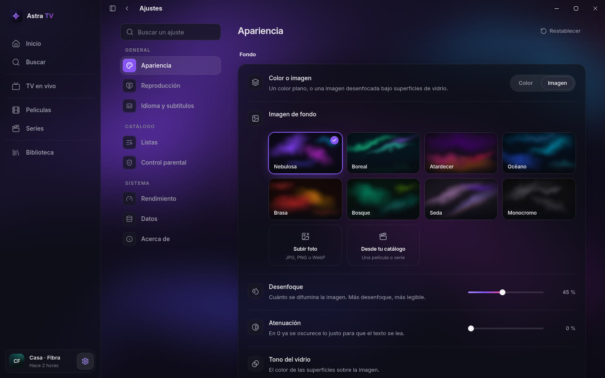

Cinco ambientes, de Medianoche a un negro OLED puro, y seis colores de acento. O una imagen de fondo: una de las incluidas, una foto tuya o la de tu película favorita, desenfocada bajo paneles de vidrio y oscurecida lo justo para que todo se lea.

- **Varias listas**, cada una con su vencimiento, sus conexiones y el alcance de su guía.
- **Categorías** fijadas, ocultas o protegidas con PIN.
- **Liviana en cualquier equipo.** En *Ajustes › Rendimiento*, apaga *Animaciones continuas* y la pantalla queda quieta mientras no la usas; apaga *Máxima calidad de imagen* si tu equipo pierde cuadros. En Android empiezan apagadas.
- **Ajustes** con buscador y *Restablecer* por sección.

<br clear="right" />
<br />

## Descarga

| | Archivo | Para |
|---|---|---|
| **Windows** | [`AstraTV.exe`](https://github.com/sbtcontreras/astra-tv-releases/releases/latest/download/AstraTV.exe) | Windows 10 y 11 de 64 bits. |
| **Android 64 bits** | [`AstraTV-arm64-v8a.apk`](https://github.com/sbtcontreras/astra-tv-releases/releases/latest/download/AstraTV-arm64-v8a.apk) | Casi todos los celulares y tablets de los últimos años. |
| **Android 32 bits** | [`AstraTV-armeabi-v7a.apk`](https://github.com/sbtcontreras/astra-tv-releases/releases/latest/download/AstraTV-armeabi-v7a.apk) | Muchas TV box y equipos para la TV, y equipos más antiguos. |

Las notas de cada versión están en [Versiones](https://github.com/sbtcontreras/astra-tv-releases/releases).

> [!NOTE]
> Astra TV es un reproductor: no incluye canales, películas ni series. Para usarlo necesitas una lista Xtream Codes de tu proveedor (servidor, usuario y contraseña).

### En Windows

1. **[Descarga `AstraTV.exe`](https://github.com/sbtcontreras/astra-tv-releases/releases/latest/download/AstraTV.exe)**.
2. Guárdalo donde quieras, incluso en un pendrive, y ábrelo. No hay nada que instalar; tus listas y ajustes quedan en cada equipo donde lo abras.
3. Agrega tu lista con el servidor, el usuario y la contraseña de tu proveedor.

La primera vez, Windows puede mostrar *«Windows protegió su PC»*: haz clic en **Más información** y luego en **Ejecutar de todas formas**. Solo ocurre una vez; si prefieres comprobar el archivo antes, sigue los pasos de [Verificar la descarga](#verificar-la-descarga).

### En Android

1. En el equipo, descarga el APK que le corresponde ([¿64 o 32 bits?](#64-o-32-bits)).
2. Ábrelo. Android te pide permitir que el navegador (o *Archivos*) instale apps: actívalo y elige **Instalar**.
3. Abre Astra TV y agrega tu lista.

**En una TV sin navegador**, instala *Downloader* desde Google Play, permítele instalar apps y escribe la dirección del APK. Para el de 64 bits:

```
github.com/sbtcontreras/astra-tv-releases/releases/latest/download/AstraTV-arm64-v8a.apk
```

Para el de 32 bits:

```
github.com/sbtcontreras/astra-tv-releases/releases/latest/download/AstraTV-armeabi-v7a.apk
```

#### ¿64 o 32 bits?

Los dos APK hacen exactamente lo mismo; cambia solo el tipo de Android que necesitan. Un procesador de 64 bits no basta: muchas TV box lo tienen y aun así traen Android de 32 bits.

- **En un celular o una tablet**, instala el de 64 bits.
- **En una TV box o un equipo para la TV**, prueba primero el de 64 bits. Si Android no lo instala (con un mensaje como *«No se instaló la app»*), tu equipo usa Android de 32 bits: instala `AstraTV-armeabi-v7a.apk`.

Después, cada equipo se actualiza solo con el mismo tipo que instalaste.

**Requisitos:** Android 8 o más nuevo y Android System WebView 120 o más nuevo (en Android 8 y 9, suele ser Google Chrome el que hace de WebView). Si el de tu equipo es más antiguo, Astra TV te lo dice al abrirse, con un botón a Google Play.

<br />

## Siempre al día

Astra TV busca versiones nuevas al abrirse y cada 6 horas. Antes de instalar una, comprueba su firma digital (ed25519) con la clave incluida en la aplicación; si no coincide, la descarta. En Windows solo te pide reiniciar; en Android abre el instalador del sistema, que acepta la versión nueva solo si viene firmada con la misma clave.

Puedes desactivar la búsqueda automática en **Ajustes › Acerca de** y buscar a mano cuando quieras. Si alguna versión empieza de cero, el aviso de actualización lo dice antes que nada, para que exportes tus listas primero (en la TV, anota el servidor, el usuario y la contraseña de cada una).

<br />

## Tus datos, en tu equipo

Listas, catálogo, favoritos, historial y ajustes se guardan en tu equipo: en Windows, en `%LOCALAPPDATA%\app.astratv.desktop`; en Android, en los datos de la aplicación. Para empezar de cero, en cualquier equipo, usa **Ajustes › Datos › Borrar todos los datos**.

Para llevar tus listas a otro equipo, expórtalas en **Ajustes › Listas › Exportar** a un archivo `.astra` e impórtalo allá, desde la bienvenida o desde **Ajustes › Listas › Importar**. En la TV, que no tiene selector de archivos, estas opciones no aparecen.

> [!WARNING]
> El archivo `.astra` incluye las contraseñas de tus listas en texto legible. Guárdalo como guardarías una contraseña y compártelo solo por un canal privado.

<br />

## Todo desde el teclado

<table>
<tr>
<td valign="top">

**Reproductor**

| Tecla | Acción |
|---|---|
| <kbd>Espacio</kbd> | Reproducir o pausar |
| <kbd>←</kbd> <kbd>→</kbd> | Retroceder o adelantar 10 s (en vivo sin retroceso: cambiar de canal) |
| <kbd>+</kbd> <kbd>−</kbd> | Volumen |
| <kbd>M</kbd> | Silenciar |
| <kbd>F</kbd> | Pantalla completa |
| <kbd>P</kbd> | Ventana flotante |
| <kbd>C</kbd> | Cambiar de subtítulos |
| <kbd>Z</kbd> <kbd>X</kbd> | Mostrar los subtítulos antes o después |
| <kbd>A</kbd> | Escalado de imagen |
| <kbd>I</kbd> | Información de la transmisión |
| <kbd>E</kbd> | Episodios |
| <kbd>Mayús</kbd> <kbd>N</kbd> | Siguiente episodio |
| <kbd>Esc</kbd> | Cerrar lo abierto, esconder los controles o volver |

</td>
<td valign="top">

**En vivo, en el reproductor**

| Tecla | Acción |
|---|---|
| <kbd>RePág</kbd> <kbd>AvPág</kbd> | Canal anterior o siguiente |
| <kbd>0</kbd>–<kbd>9</kbd> | Ir a un canal por su número |
| <kbd>Retroceso</kbd> | Volver al canal anterior |
| <kbd>Fin</kbd> | Ir al vivo |
| <kbd>L</kbd> | Lista de canales |

**En TV en vivo**

| Tecla | Acción |
|---|---|
| <kbd>↑</kbd> <kbd>↓</kbd> | Recorrer los canales |
| <kbd>Intro</kbd> | Ver en pantalla completa |
| <kbd>F</kbd> | Agregar o quitar de Favoritos |
| <kbd>G</kbd> | Canales o Guía |

**Toda la aplicación**

| Tecla | Acción |
|---|---|
| <kbd>Ctrl</kbd> <kbd>K</kbd> | Buscar |
| <kbd>/</kbd> | Buscar en esta pantalla |
| <kbd>←</kbd> <kbd>↑</kbd> <kbd>→</kbd> <kbd>↓</kbd> | Moverse por la pantalla |

</td>
</tr>
</table>

Con el control remoto también funcionan sus teclas de reproducir, pausar, adelantar y retroceder, CH+ y CH−, e Info.

<br />

## Verificar la descarga

Cada archivo se publica junto a su huella SHA-256: `AstraTV.exe.sha256`, `AstraTV-arm64-v8a.apk.sha256` y `AstraTV-armeabi-v7a.apk.sha256`. Compruébala en PowerShell, en la carpeta de la descarga:

```powershell
(Get-FileHash .\AstraTV.exe -Algorithm SHA256).Hash.ToLower()
Get-Content .\AstraTV.exe.sha256
```

Si el primer valor coincide con el comienzo del segundo, el archivo es exactamente el que se publicó. Para un APK descargado en el PC, cambia el nombre del archivo en los dos comandos.

<br />

## Preguntas frecuentes

<details>
<summary><b>¿Astra TV incluye canales, películas o series?</b></summary>
<br />
No. Astra TV es el reproductor: muestra el catálogo de la lista Xtream Codes que te entrega tu proveedor.
</details>

<details>
<summary><b>¿Funciona con listas M3U?</b></summary>
<br />
Por ahora, solo con listas Xtream Codes (servidor, usuario y contraseña).
</details>

<details>
<summary><b>Android no instala el APK. ¿Qué hago?</b></summary>
<br />
Si probaste el de 64 bits, tu equipo usa Android de 32 bits: instala <a href="https://github.com/sbtcontreras/astra-tv-releases/releases/latest/download/AstraTV-armeabi-v7a.apk"><code>AstraTV-armeabi-v7a.apk</code></a>. Pasa en muchas TV box, aunque su procesador sea de 64 bits.
</details>

<details>
<summary><b>Al abrirla, me pide actualizar Android System WebView.</b></summary>
<br />
Astra TV dibuja su interfaz con el WebView de Android, y necesita la versión 120 o más nueva. Elige <b>Abrir Google Play</b>, actualízalo (en Android 8 y 9, actualiza también Google Chrome) y vuelve a abrir Astra TV. Algunas TV box sin Google Play no pueden actualizarlo; en ellas Astra TV no funciona.
</details>

<details>
<summary><b>Un canal se corta a los pocos segundos. ¿Por qué?</b></summary>
<br />
Casi siempre es porque tu cuenta está usando todas sus conexiones, por ejemplo con otro equipo viendo la misma lista. Astra TV te avisa cuando llegas al límite, y en <b>Ajustes › Listas</b>, en la página de tu lista, ves cuántas conexiones permite tu cuenta.
</details>

<details>
<summary><b>¿Por qué Windows dice que la aplicación no es reconocida?</b></summary>
<br />
SmartScreen avisa de los programas que todavía no descarga mucha gente. Las actualizaciones que instala la propia aplicación van firmadas, y puedes comprobar cada descarga con su huella SHA-256 (<a href="#verificar-la-descarga">Verificar la descarga</a>).
</details>

<details>
<summary><b>¿Cómo la desinstalo?</b></summary>
<br />
En Windows, borra <code>AstraTV.exe</code>; si también quieres quitar tus datos, borra la carpeta <code>%LOCALAPPDATA%\app.astratv.desktop</code>. En Android, desinstálala como cualquier aplicación: sus datos se van con ella.
</details>

<br />
<br />

<div align="center">

<br />
<sub>Astra TV · Windows 10 y 11 · Android 8 o más nuevo</sub>
</div>
