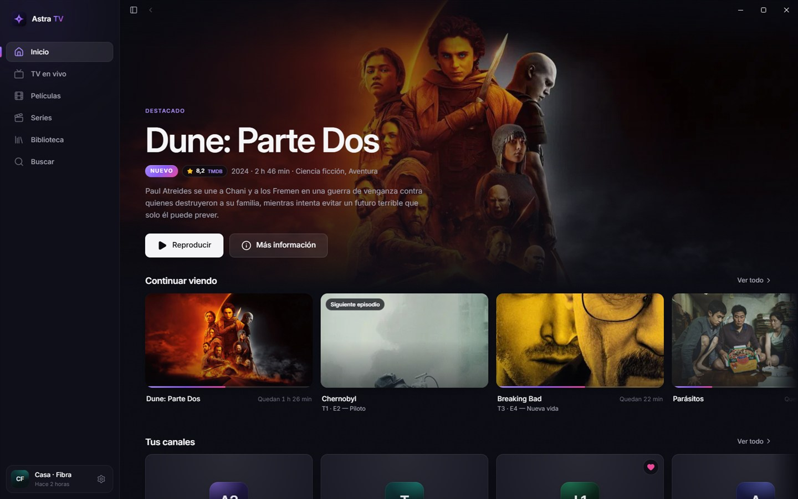

<div align="center">


# Astra TV

**Tu lista Xtream Codes, como se merece verse.**<br />
TV en vivo con guía, películas y series en una sola app para Windows. Portable, rápida y privada.

<br />

<a href="https://github.com/sbtcontreras/astra-tv-releases/releases/latest/download/AstraTV.exe"></a>

<br />
<br />

<a href="https://github.com/sbtcontreras/astra-tv-releases/releases/latest"></a>
<a href="https://github.com/sbtcontreras/astra-tv-releases/releases"></a>


<br />
<br />


<sub>Un solo <code>AstraTV.exe</code> de unos 40 MB · Sin instalación · Tus datos nunca salen de tu equipo</sub>

</div>

<br />

## Por qué Astra TV

<table>
<tr>
<td width="33%" valign="top">

### Hecha para ver

Carátulas, logos de los títulos, reparto con fotos y valoraciones de TMDB. Tu catálogo se ve como una plataforma de streaming, no como una lista de texto.

</td>
<td width="33%" valign="top">

### Rápida de verdad

El catálogo se guarda en tu equipo: abrir una categoría, buscar o cambiar de canal es inmediato, aunque tu lista tenga miles de títulos.

</td>
<td width="33%" valign="top">

### Privada

Tus credenciales solo se usan para conectarse con tu proveedor. Listas, historial y ajustes se quedan en tu equipo. Sin cuentas, sin anuncios, sin rastreo.

</td>
</tr>
</table>

## TV en vivo

Cambia de canal con el teclado, mira la programación de un vistazo y vuelve atrás si te perdiste algo.

<p align="center">
  
  
</p>

- **Vista previa** del canal mientras recorres la lista, con lo que se emite ahora y cuánto le queda.
- **Guía** en grilla de todos los canales (XMLTV), con filtro «Con guía» y navegación por días.
- **Repetición**: mira desde el inicio los programas que ya se emitieron, si tu proveedor lo permite.
- **Retroceder en vivo**: pausa sin perder nada, retrocede o adelanta 10 s y arrastra la línea de tiempo, que marca dónde empieza cada programa. **Ir al vivo** (o la tecla Fin) te devuelve a lo que se emite ahora. Tú eliges cuánta memoria usa, de 25 MB a 1 GB.
- **Zapping** con banner del canal, número de canal desde el teclado y Retroceso para volver al anterior.
- Si la señal se cae, Astra TV **se reconecta sola**.

## Películas y series

<p align="center">
  
  
</p>

- **Fichas completas**: sinopsis, reparto, tráiler, estreno, clasificación y «Más como esta».
- **Continuar viendo** retoma donde quedaste y, en las series, pasa solo al siguiente episodio, con cuenta regresiva.
- Recuerda el **audio y los subtítulos** que elegiste para cada serie, y los subtítulos aparecen solos cuando el audio está en otro idioma.
- Marca como visto un episodio, una temporada o la serie completa. Todo se puede deshacer.
- **Biblioteca**: tu historial ordenado por día y tus favoritos, filtrables por películas, series o TV en vivo.
- **Buscar** en todo el catálogo con Ctrl+K, o dentro de la categoría que tienes abierta con /.

## Un reproductor que no te interrumpe

- **Mini reproductor**: sal de lo que estás viendo y sigue reproduciéndose en una esquina mientras navegas. Se expande sin recargar.
- **Ventana flotante** (P): el video siempre visible sobre tus otras ventanas.
- Ajusta la **imagen** (A): ajustar, rellenar, estirar o forzar 16:9, 4:3 y 21:9.
- **Información de la transmisión** (I): resolución, video, audio, descarga y búfer.
- Reproducción con **libmpv**: arranca rápido y lee prácticamente cualquier formato.

## A tu manera


- **Apariencia**: cinco ambientes (Medianoche, Grafito, Abismo, Aurora y OLED), color de acento, luz ambiental, tamaño de las carátulas y la pantalla con la que se abre la app.
- **Fondos con imagen**: uno de los incluidos, tu propia foto o la imagen de una película o serie, desenfocada bajo paneles de vidrio.
- **Varias listas**, con sincronización manual o automática, y la información de cada cuenta: vencimiento, conexiones y hasta cuándo llega su guía.
- **Categorías** fijadas arriba, ocultas o bloqueadas.
- **Control parental** con PIN para bloquear categorías.
- **Ajustes con buscador** (Ctrl+F) y «Restablecer» por sección.

<br clear="right" />

## Atajos de teclado

<table>
<tr>
<td valign="top">

**En el reproductor**

| Tecla | Acción |
|---|---|
| <kbd>Espacio</kbd> / <kbd>K</kbd> | Reproducir o pausar |
| <kbd>←</kbd> <kbd>→</kbd> | Retroceder o adelantar 10 s |
| <kbd>↑</kbd> <kbd>↓</kbd> | Volumen |
| <kbd>M</kbd> | Silenciar |
| <kbd>F</kbd> / <kbd>F11</kbd> | Pantalla completa |
| <kbd>P</kbd> | Ventana flotante |
| <kbd>C</kbd> | Cambiar subtítulos |
| <kbd>A</kbd> | Ajuste de imagen |
| <kbd>I</kbd> | Información de la transmisión |
| <kbd>Mayús</kbd> + <kbd>N</kbd> | Siguiente episodio |
| <kbd>E</kbd> | Episodios |

</td>
<td valign="top">

**En TV en vivo**

| Tecla | Acción |
|---|---|
| <kbd>RePág</kbd> <kbd>AvPág</kbd> | Canal anterior o siguiente |
| <kbd>0</kbd>–<kbd>9</kbd> | Ir a un número de canal |
| <kbd>Retroceso</kbd> | Volver al canal anterior |
| <kbd>L</kbd> | Lista de canales |
| <kbd>G</kbd> | Cambiar entre Canales y Guía |
| <kbd>Fin</kbd> | Ir al vivo |

**En toda la app**

| Tecla | Acción |
|---|---|
| <kbd>Ctrl</kbd> + <kbd>K</kbd> | Buscar |
| <kbd>/</kbd> | Buscar en la pantalla |

</td>
</tr>
</table>

## Instalar

1. **[Descarga `AstraTV.exe`](https://github.com/sbtcontreras/astra-tv-releases/releases/latest/download/AstraTV.exe)** desde la última versión.
2. Guárdalo donde quieras (Escritorio, una carpeta o un pendrive) y ábrelo. No requiere instalación.
3. Agrega tu lista con el servidor, el usuario y la contraseña que te dio tu proveedor. Listo.

**Requisitos**: Windows 10 u 11 de 64 bits. La app usa WebView2, que ya viene incluido en Windows 10 y 11.

> [!NOTE]
> Astra TV es un reproductor: no incluye canales, películas ni series. Necesitas una lista Xtream Codes de tu proveedor.

### Primer inicio: aviso de SmartScreen

Windows puede mostrar *«Windows protegió tu PC»* la primera vez que abres `AstraTV.exe`. Para continuar:

1. Haz clic en **Más información**.
2. Haz clic en **Ejecutar de todas formas**.

Solo tienes que hacerlo una vez. Si prefieres comprobar el archivo antes, mira [Verificar la descarga](#verificar-la-descarga).

## Actualizaciones

Astra TV busca versiones nuevas en esta página al abrirse y cada 6 horas. Cuando hay una, la descarga, comprueba su **firma digital (ed25519)** con la clave incluida en la app y, si es válida, reemplaza el ejecutable y te pide reiniciar. Si la firma no coincide, la descarga se descarta.

Puedes desactivar la búsqueda automática en **Ajustes**; buscar a mano siempre está disponible.

> [!IMPORTANT]
> Si usas la v0.1.0, descarga la última versión desde esta página una sola vez. Desde la v0.2.0, las actualizaciones son automáticas.

Lo nuevo de cada versión está en [Versiones](https://github.com/sbtcontreras/astra-tv-releases/releases).

## Tus datos

Todo se guarda en tu equipo, en:

```
%LOCALAPPDATA%\app.astratv.desktop
```

Ahí están tus listas, el catálogo descargado, favoritos, historial y ajustes. Para empezar de cero, usa **Ajustes › Datos › Borrar todos los datos**, o cierra la app y elimina esa carpeta.

### Llevar tus listas a otro equipo

Exporta tus listas desde **Ajustes** a un archivo `.astra` e impórtalo en el otro equipo.

> [!WARNING]
> El archivo `.astra` contiene las **contraseñas** de tus listas en texto legible. Trátalo como una contraseña: no lo publiques y compártelo solo por un canal privado.

## Verificar la descarga

Cada versión incluye, junto a `AstraTV.exe`, el archivo `AstraTV.exe.sha256` con la huella SHA-256 del ejecutable. Para comprobarla en PowerShell:

```powershell
(Get-FileHash .\AstraTV.exe -Algorithm SHA256).Hash.ToLower()
Get-Content .\AstraTV.exe.sha256
```

Si el primer valor coincide con el comienzo de `AstraTV.exe.sha256` (antes de los dos espacios), el archivo es el que se publicó.

## Preguntas frecuentes

<details>
<summary><b>¿Astra TV trae canales o contenido?</b></summary>
<br />
No. Astra TV es solo el reproductor: muestra el catálogo de la lista Xtream Codes que te da tu proveedor.
</details>

<details>
<summary><b>¿Funciona con listas M3U?</b></summary>
<br />
Por ahora, solo con listas Xtream Codes (servidor, usuario y contraseña).
</details>

<details>
<summary><b>Un canal se corta a los pocos segundos o no carga. ¿Qué pasa?</b></summary>
<br />
Lo más común es que tu cuenta esté usando todas sus conexiones al mismo tiempo (otro dispositivo viendo la misma lista). Astra TV te avisa cuando llegas al límite; puedes ver cuántas conexiones permite tu cuenta en <b>Ajustes › Listas</b>.
</details>

<details>
<summary><b>¿Por qué Windows dice que la app no es reconocida?</b></summary>
<br />
SmartScreen avisa de los programas que todavía no descargó mucha gente. Las actualizaciones de Astra TV van firmadas, y puedes comprobar cada descarga con su huella SHA-256 (<a href="#verificar-la-descarga">Verificar la descarga</a>).
</details>

<details>
<summary><b>¿Cómo desinstalo Astra TV?</b></summary>
<br />
Borra <code>AstraTV.exe</code> y, si quieres quitar también tus datos, la carpeta <code>%LOCALAPPDATA%\app.astratv.desktop</code>.
</details>

<br />

<div align="center">

<br />
<sub>Astra TV para Windows</sub>
</div>
